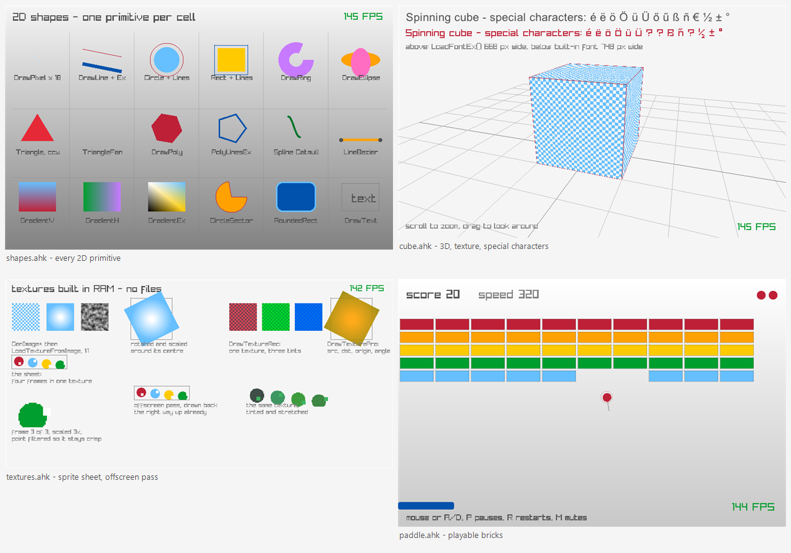

# raylib.ahk

[raylib](https://www.raylib.com) 5.5 for AutoHotkey v2: windowed graphics, shapes, images,
textures, custom fonts, 3D and audio, driven straight from a script.

Everything in `lib/raylib.ahk` is generated from the official `raylib.h`, so the bindings
track the library instead of drifting from it. Of raylib's 581 functions **497 are bound**:
218 through plain `DllCall`, 279 through a small companion DLL, and 84 left out on purpose
(with the reason written down in [tools/skipped.txt](tools/skipped.txt)).



```ahk
#Requires AutoHotkey v2.0
#Include %A_ScriptDir%\..\lib\raylib.ahk

RL.InitWindow(320, 200, "raylib.ahk")
RL.SetTargetFPS(60)
while !RL.WindowShouldClose() {
    RL.BeginDrawing()
    RL.ClearBackground(RL.RAYWHITE)
    RL.DrawCircle(160, 100, 40, RL.SKYBLUE)
    RL.DrawText("hello from AutoHotkey", 90, 20, 20, RL.DARKGRAY)
    RL.EndDrawing()
}
RL.CloseWindow()
```

## Run it

You need **64-bit AutoHotkey v2** (`AutoHotkey64.exe`) — the shipped DLLs are x64. Nothing
else: no compiler, no raylib install, no runtime redist.

```
git clone https://github.com/bceenaeiklmr/raylib_ahk
cd raylib_ahk
"C:\Program Files\AutoHotkey\v2\AutoHotkey64.exe" examples\demo.ahk
```

`lib/raylib.ahk` loads `raylib.dll` and `raylib_ahk_shim.dll` from its own folder at include
time, so any script that `#Include`s it works from any working directory.

## How the binding works

`DllCall` can pass and return machine words: integers, floats, pointers, and — on x64 — a
struct of four bytes such as `Color`. Anything bigger cannot cross that boundary: Windows
copies large structs into a hidden stack area, and `DllCall` has no way to describe what it
is passing or receiving. That rules out `Texture2D`, `Image`, `Font`, `Camera3D`, `Sound`,
`Wave`, `Ray`, `BoundingBox` and friends: 433 of raylib's functions.

The generator classifies every function and picks the cheapest bridge that works.

**1. Direct `DllCall`** when every argument and the result fits a register.

```ahk
; Color Fade(Color color, float alpha)   ; Color is 4 bytes, so it fits in a register
static Fade(rlColor, rlAlpha) {
    return RL.RGBA(DllCall("raylib.dll\Fade", "UInt", RL.ABGR(rlColor), "Float", rlAlpha, "UInt"))
}
```

`Vector2`, `Vector3`, `Vector4` and `Rectangle` are made of floats, so their fields become
plain number parameters and a returned one comes back as an array:

```ahk
pos := RL.GetMousePosition()        ; [x, y]
RL.DrawCircle(pos[1], pos[2], 20, RL.RED)
```

**2. Buffers for structs, through the shim.** Each function that needs a struct by value
gets a flat C wrapper in `vendor/shim.c`. It takes pointers, assembles the struct, and calls
raylib. AutoHotkey allocates the memory and only ever sees a pointer, so the struct size and
field layout live in exactly two generated places:

```c
/* vec2 fields arrive as their own floats; the Texture arrives through a pointer */
RLA void rla_DrawTexturePro(Texture *texture, float sourceX, float sourceY,
        float sourceWidth, float sourceHeight, float destX, float destY, float destWidth,
        float destHeight, float originX, float originY, float rotation,
        unsigned int tintRaw) {
    Rectangle source = { sourceX, sourceY, sourceWidth, sourceHeight };
    Rectangle dest = { destX, destY, destWidth, destHeight };
    Vector2 origin = { originX, originY };
    Color tint = { (unsigned char)(tintRaw), (unsigned char)(tintRaw >> 8),
                   (unsigned char)(tintRaw >> 16), (unsigned char)(tintRaw >> 24) };
    DrawTexturePro(*texture, source, dest, origin, rotation, tint);
}
```

```ahk
tex := RL.LoadTexture("player.png")             ; -> Buffer(20), one Texture
RL.DrawTexturePro(tex, 0, 0, 32, 32, 100, 100, 64, 64, 32, 32, 0, RL.WHITE)
RL.UnloadTexture(tex)
```

`lib/raylib_ahk_shim.dll` sits next to `raylib.dll` and is loaded with it. It is a thin
forwarding layer against the *same* `raylib.dll`, so textures, fonts, meshes and audio
streams stay in one raylib context — no second copy of the library, no second GL context.

**3. Struct accessors as generated methods.** Every field of every struct is read and
written through a generated pair of methods, nested fields included, so no script hardcodes
an offset:

```ahk
RL.Camera3D_PositionX(cam, 4.0)                  ; camera.position.x
RL.Camera3D_TargetY(cam, 1.5)
RL.RenderTexture2D_TextureWidth(rt)              ; rt.texture.width
RL.SetMaterialTexture(RL.Model_Materials(model), ; materials[0]: a pointer field gives back
    RL.MATERIAL_MAP_DIFFUSE, tex)                ; an address, which these methods take
```

**The layout is checked at run time, not assumed.** The generator also emits
`RL.VerifyLayout()`, which asks the C compiler (through the shim) for the size and offset of
every field of all 25 structs and compares them to the offsets baked into the accessors. It
runs at startup: a mismatch throws instead of drawing garbage.

Two sizes worth knowing: a `Texture` is 20 bytes and a `Font` is 48, which is why neither can
cross `DllCall`.

## Conventions

| Raylib type | In AutoHotkey |
|---|---|
| `Color` | plain `0xRRGGBBAA` integer, same order as `RL.RED` and `ColorToInt()`; `RL.ABGR()`/`RL.RGBA()` do the byte swap |
| `Vector2/3/4`, `Rectangle` | numbers in, array out: `[x, y]`, `[x, y, z]`, `[x, y, w, h]` |
| any other struct | a `Buffer` returned by the loader, passed back to every method that takes it |
| struct fields | `RL.<Struct>_<Field>(buf)` / `RL.<Struct>_<Field>(buf, value)`; nested paths included (`RL.Camera3D_PositionX`), pointer fields give back an address |
| `const char *` | AutoHotkey strings, converted to UTF-8 by `RL.U8()` — so accents and CJK work |
| `const Vector2 *points, int count` | one flat array: `RL.DrawPoly([x1, y1, x2, y2, x3, y3], 3, color)` |
| `const int *codepoints, int count` | `RL.Codepoints("őű")` builds the buffer, `cps.Size // 4` is the count |
| `bool` | `Char` in the call, truthy in the script |
| a screenshot | `RL.ScreenShot("C:\full\path.png")`; `TakeScreenshot()` takes a bare name only |
| `Camera3D` / `Camera2D` | `RL.MakeCamera3D(pos, target, up, fovy, proj)` / `RL.MakeCamera2D(offset, target, rotation, zoom)` |

Callbacks are deliberately absent: `SetTraceLogCallback`, `SetAudioStreamCallback` and the
automation-event hooks would need a function pointer that outlives the script that installed
it.

## What you can do

| Area | Bound | Notes |
|---|---|---|
| window, input, timing | 121 | keyboard, mouse, gamepad, touch/gestures, cursor |
| 2D shapes & text | 56 | pixels, lines, circles, ellipses, rings, polys, splines, both text renderers |
| textures & images | 109 | load/generate/upload/draw/unload, tinting, sprite sheets, `GenImage*`, `Export*` |
| fonts | 12 | `LoadFontEx` from any TTF, explicit codepoint baking, `DrawTextEx`, `MeasureTextEx` |
| 3D | 87 | `Camera3D`, `BeginMode3D`, cubes/spheres/cylinders/planes/rays, grids, picking, collision |
| models & meshes | 55 | `LoadModel` (gltf/obj/vox), `DrawModel`, `LoadMeshFromModel`, animations |
| shaders & materials | 15 | `LoadShader`, uniforms, custom vertex data |
| render textures | 11 | offscreen passes, `GetTexture` |
| audio | 58 | `LoadSound`, `LoadMusicStream` + streaming loop, `Wave` inspection, `SetSoundVolume` |
| files & paths | 15 | `FileExists`, `GetFileName*`, `DirectoryExists` |
| colour & math | 13 | `Fade`, `ColorTint`, `Clamp`, `Lerp`, `Normalize`, `Vector*` helpers |

Left out: raw memory and file-byte helpers (`MemAlloc`, `LoadFileData`, `LoadUTF8`, the
`Text*` helpers — AutoHotkey has `Buffer`, `FileRead` and `StrLen`), exporters that return
source code, callbacks, VR stereo, `FilePathList`, and font baking. Each reason is listed per
function in `tools/skipped.txt`.

## Examples

Every demo takes `/auto[:ms]` (close by itself) and `/shot:name` (write
`tests\out\name.png`), so all of them run headless. [`examples/harness.ahk`](examples/harness.ahk)
holds that plumbing, a TTF finder and an error handler that makes a headless failure exit
non-zero instead of leaving a frozen window behind.

| File | Shows |
|---|---|
| [`demo.ahk`](examples/demo.ahk) | gravity, wall bounces, a cursor spring, a trail buffer, keyboard and mouse input, live HUD |
| [`shapes.ahk`](examples/shapes.ahk) | every 2D primitive in one labelled grid: pixels, lines, bezier, circles, rings, ellipses, triangles, polygons, fans, splines, gradients, rounded rects |
| [`textures.ahk`](examples/textures.ahk) | textures generated in RAM, tinting, rotation about a chosen origin, a four-frame sprite sheet built by an offscreen pass, sub-rectangles, point filtering |
| [`fonts.ahk`](examples/fonts.ahk) | `LoadFontEx` from a TTF with only the codepoints needed, sizes and spacing, `MeasureTextEx` centring, `DrawTextPro` pivoting, accents beside the built-in font's question marks |
| [`input.ahk`](examples/input.ahk) | held-key panel, UTF-8 text gathered from `GetKeyPressed`, the five mouse buttons, wheel zoom, cursor visibility, gamepad buttons and axes that appear when a pad is plugged in |
| [`paddle.ahk`](examples/paddle.ahk) | a playable brick game: delta-time physics, `CheckCollisionCircleRec`, a new angle depending on where the ball meets the paddle, score and lives, two sound effects synthesised as WAV bytes in RAM |
| [`cube.ahk`](examples/cube.ahk) | 3D orbital camera, a RAM texture mapped onto a model with `SetMaterialTexture`, and a caption of special characters drawn twice: correctly by the TTF, and by the built-in font |

## Tests

```
powershell -ExecutionPolicy Bypass -File tools\check_all.ps1
```

That regenerates both artifacts, rebuilds the shim, checks the struct model against the
compiler, checks every `RL.` name used by a script against the wrapper, validates each file
with `/Validate`, runs the test suite, and runs all seven demos headlessly with a screenshot
in `tests\out`.

`tests/smoke.ahk` is not a smoke test in name only: it renders known pixel patterns, reads
them back with `LoadTextureFromImage` + `GetPixelColor`, and fails loudly if a binding is
wired wrong. 69 checks cover the constant and colour conventions, shape winding, `Color`
by value, `Vector2` in and out, UTF-8 text, tinting, sprite-sheet sub-rectangles, custom
fonts with baked codepoints, 3D projection (a cube must move when its x does), the grid,
WAV decoding from a file and from memory, silent playback, `RL.ScreenShot()` round-tripping
the framebuffer through a PNG, and struct accessors writing as well as reading.

```
checks: 69, failures: 0
```

Because it asserts on pixels, the failure modes are readable:

```
FAIL  the cube projects left when its x is negative
```

## Rebuilding after a raylib update

```powershell
powershell -ExecutionPolicy Bypass -File tools\get_raylib.ps1   # fetch a release (edit $RaylibVer to change version)
python tools\gen_wrapper.py                                     # -> lib\raylib.ahk, vendor\shim.c, vendor\raylib.def
powershell -ExecutionPolicy Bypass -File tools\build_shim.ps1   # -> lib\raylib_ahk_shim.dll (needs MSVC Build Tools)
python tools\check_layout.py                                    # confirm the struct model matches the compiler
powershell -ExecutionPolicy Bypass -File tools\check_all.ps1    # everything, end to end
```

`tools/gen_wrapper.py` reads `vendor/raylib.h` only: no libclang, no compiler, no internet.
Building the shim needs a C compiler and the raylib **DLL**, never `raylib.lib` — linking the
static library would embed a second copy of raylib with its own window and GL context.

## Gotchas found the hard way

- **`Array.Delete(pos)` does not shorten an array.** It marks the slot and leaves `Length`
  alone, so a `while arr.Length > n` trim loop after `Delete(1)` spins forever and the window
  stops responding at the frame where trimming starts. Use `Array.RemoveAt(1, count)` — it
  shifts and shrinks. `tests/smoke.ahk` asserts this behaviour so the trap cannot come back
  silently.
- **`A_TickCount` is system uptime**, not time since the script started. Measure a run with
  `start := A_TickCount` and subtract.
- **`SetTargetFPS(60)` gives about 41 fps on Windows** because the sleep granularity is
  ~15.6 ms and each frame overshoots its budget. Ask for `FLAG_VSYNC_HINT` at `InitWindow`
  instead and frames land on the display refresh (145 fps measured on a 144 Hz panel).
- **Screenshots need care.** `TakeScreenshot()` accepts a bare file name only (a path with
  separators is rejected), resolves it against the working directory raylib captured at
  startup, and reads one buffer swap behind, so `SetWorkingDir()` after `InitWindow()` has
  no effect and the first frame comes back empty. `RL.ScreenShot(FullPath)` takes an
  absolute path, throws if the write fails, and is what the examples and tests use:

  ```ahk
  SetWorkingDir A_ScriptDir "\..\tests\out"      ; before InitWindow; A_WorkingDir resolves ".."
  ShotPath := A_WorkingDir "\frame.png"
  ; ... later, after a frame has been drawn
  RL.ScreenShot(ShotPath)
  ```
- **`DrawTriangleFan` wants counter-clockwise points**; raylib culls clockwise polygons and
  the fan silently draws nothing.
- **`DllCall`'s `"Str"` uses the system codepage**, which mangles everything outside ASCII.
  The bindings convert to UTF-8 explicitly (`RL.U8`) and read back with `StrGet(..., "UTF-8")`,
  because raylib's API is UTF-8. The returned pointer must be read before the string buffer
  goes out of scope, so every text-returning method binds it to a local first.
- **`bool` returns need the `"Char"` type**: only the low byte is meaningful, and reading a
  dword sees stack garbage above it.
- **`raymath.h` is a header of `static inline` functions**, so `Clamp`, `Lerp` and the
  `Vector*` helpers are not symbols in `raylib.dll` and no binding can reach them. Two
  lines of AutoHotkey is cheaper than a shim.
- **The palette has 26 names, and NAVY and SILVER are not among them.**
  `tools/check_names.py` reports every `RL.Something` the wrapper does not define, so an
  invented constant fails a check instead of failing at runtime.
- **`LoadWaveFromMemory()` wants the type with its dot**: `.wav` decodes, `wav` is refused
  as an unsupported format. That is how `paddle.ahk` gets sound effects out of bytes in RAM.
- **A render texture already comes back the right way up in 5.5.** Drawing it with a
  negative destination height flips it a second time and moves the picture outside the box
  it was measured for; plain coordinates are correct, and `textures.ahk` shows that.
- **AutoHotkey owns the names `Floor`, `Ceil`, `StrLen`...** Methods and locals in the
  generated file are prefixed `rl*` for that reason.
- **The default raylib font covers 224 glyphs.** Anything outside it, including most of
  Central European Latin, renders as blanks: pass a TTF to `RL.LoadFontEx`. With `0, 0` for
  the last two parameters it loads the same 224-glyph set from that TTF; pass
  `RL.Codepoints("őű")` and its length to bake exactly the characters you need.
  `tests/smoke.ahk` compares the two: the built-in font draws `ő` as nothing, the TTF draws it.

## Layout

```
lib/raylib.ahk              generated bindings: 497 functions, 308 constants, 26 colours, 25 structs
lib/raylib.dll              raylib 5.5, win64
lib/raylib_ahk_shim.dll     generated flat wrappers for struct-by-value functions
vendor/raylib.h             the header the bindings are generated from
vendor/shim.c               generated shim source
vendor/raylib.def           generated export list, used to build the shim
tools/gen_wrapper.py        the generator
tools/build_shim.ps1        builds the shim with MSVC Build Tools
tools/get_raylib.ps1        downloads a raylib release and refreshes vendor/ and lib/
tools/check_layout.py       compares the generator's struct model with the compiler's
tools/run_ahk.ps1           runs a script headlessly with the 64-bit interpreter
tools/check_names.py        reports RL.<name> uses that the wrapper does not define
tools/check_all.ps1         the whole verification chain
tools/skipped.txt           every unbound function, with its reason
tools/precheck.py           encoding, dead-link and stale-number checks before publishing
tools/fix_mojibake.py       repairs text double-encoded by Windows PowerShell 5.1
tools/preview.ps1           builds docs/preview.png out of the demo screenshots
tests/smoke.ahk             69 pixel-level checks
examples/                   seven runnable demos plus harness.ahk
docs/preview.png            the image at the top of this file
legacy/                     the hand-written v0.1 wrapper, for reference
```

## License

The wrapper, the generator and the demos are MIT - see [LICENSE](LICENSE). raylib 5.5 itself is
zlib licensed; its license text ships in [vendor/LICENSE](vendor/LICENSE), and `lib/raylib.dll`
is that same library, unmodified, from the official release.
